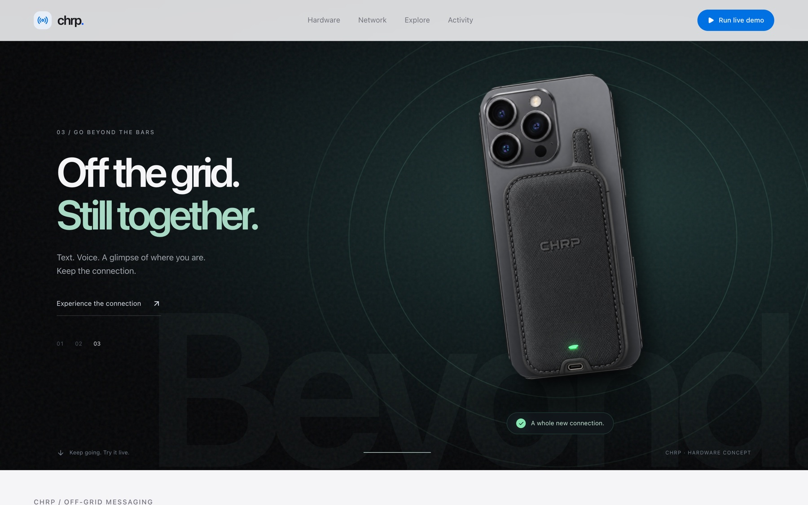
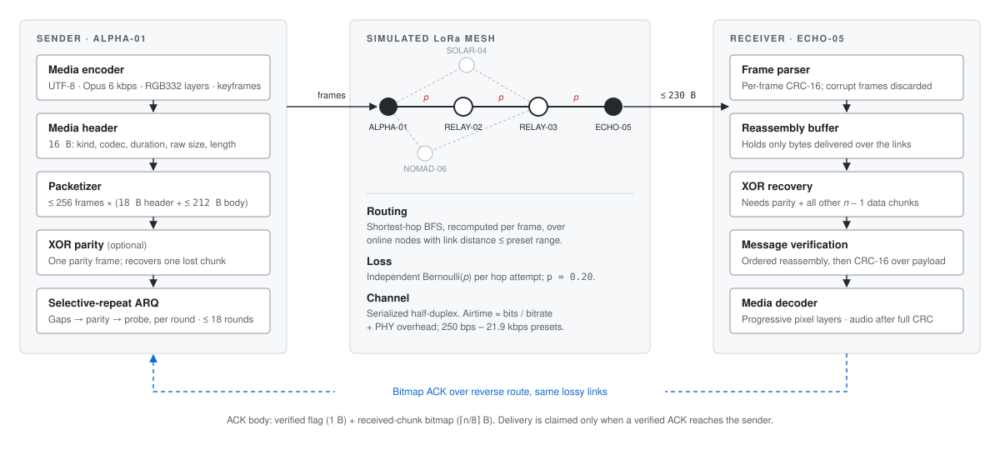
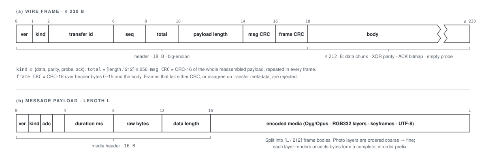
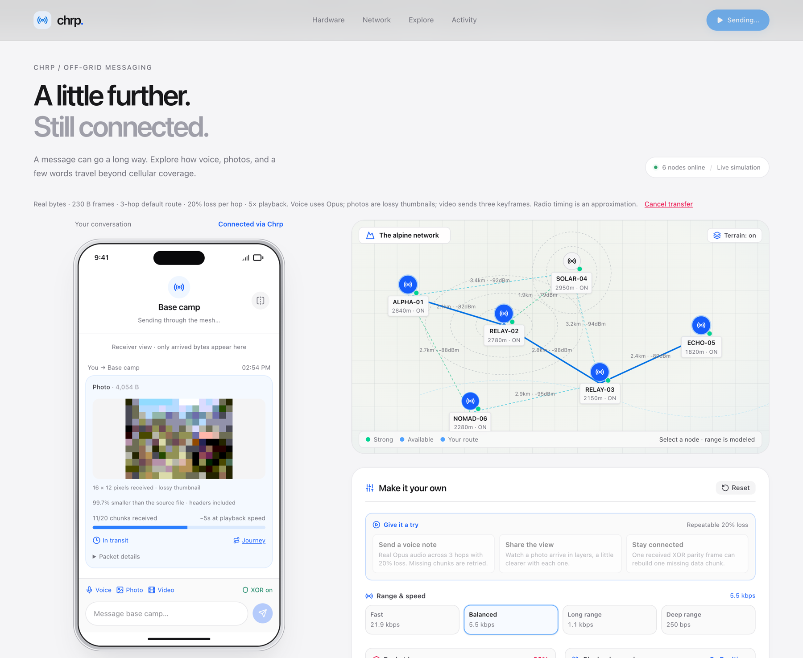
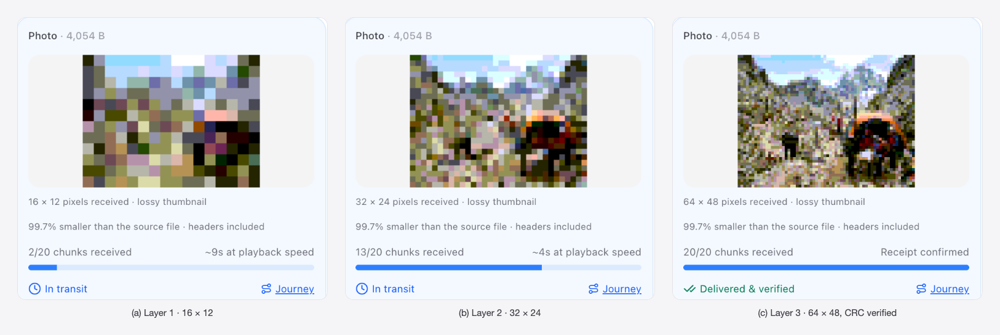
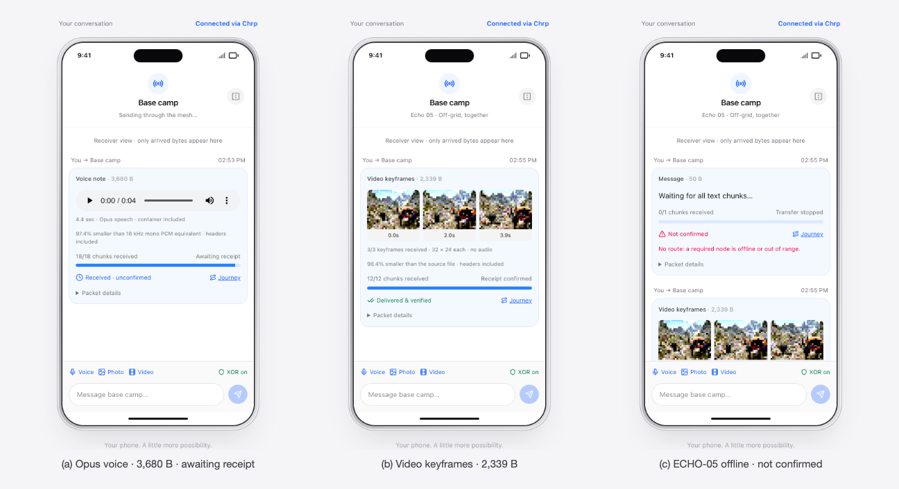
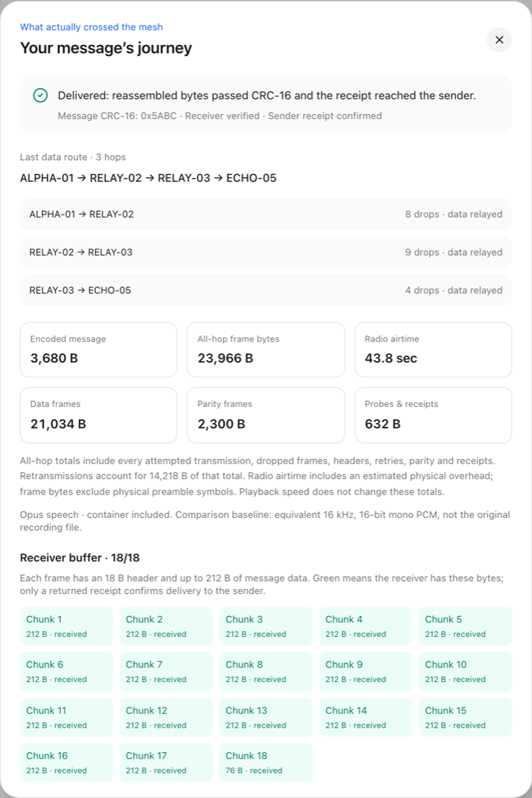
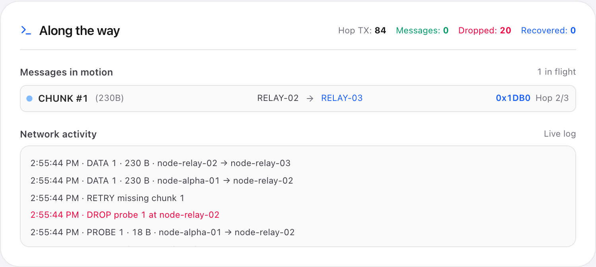
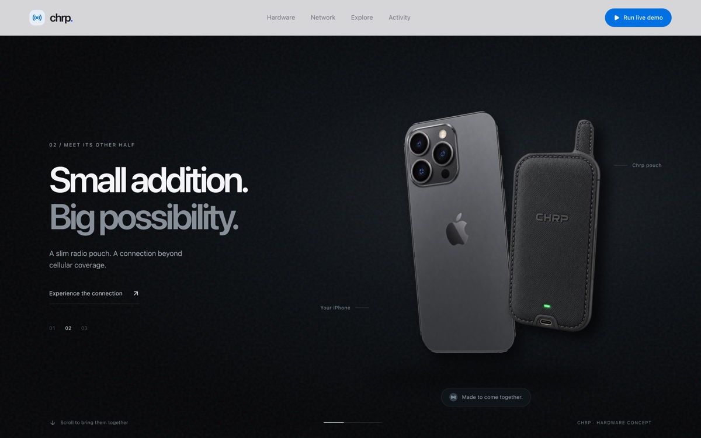
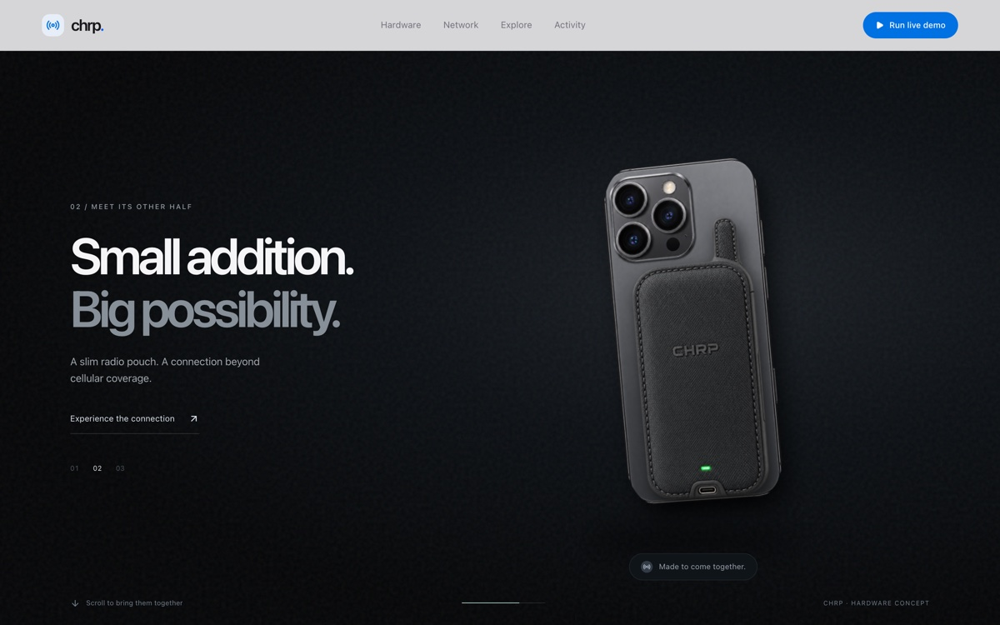

<div align="center">

# SkyWire

**Voice, photos and text over a 230-byte LoRa mesh, simulated byte for byte in the browser.**




</div>

## Abstract

LoRa radios reach tens of kilometres without cellular coverage, but they carry only a few hundred bytes per frame at
0.25–22 kbps. SkyWire asks how much of a modern message survives that budget. We encode speech with Opus at 6 kbps,
photos as three progressive RGB332 pixel layers, and video as a three-keyframe storyboard. Each message is split
into ≤ 230-byte frames and sent across a six-node simulated mesh with 20 % independent loss on every hop. Delivery
uses selective-repeat ARQ, optional XOR parity and end-to-end CRC-16. The receiver holds only the bytes that crossed
the simulated links, and a message counts as delivered only when the receiver's verified ACK reaches the sender. On
the default three-hop route, a 4.4 s voice note (3,680 B) and a 64 × 48 photo (4,054 B) were each confirmed in
100 of 100 seeded runs.

## Contents

[Architecture](#1-architecture) · [Interface](#2-interface) · [Results](#3-results) ·
[Quick start](#4-quick-start) · [Limitations](#5-limitations) · [Repository layout](#6-repository-layout)

---

## 1. Architecture

<p align="center"></p>

<p align="center"><em><b>Figure 1.</b> End-to-end transfer pipeline. The sender sends frames forward along a shortest-hop
route, and every hop attempt can be lost with probability <i>p</i>. The receiver's bitmap ACK returns over the same
lossy links, so delivery cannot be confirmed until that ACK arrives.</em></p>

<p align="center"></p>

<p align="center"><em><b>Figure 2.</b> (a) Wire frame: an 18-byte header followed by a body of up to 212 bytes. (b) The
message payload: a 16-byte media header followed by the encoded media, split across frame bodies.</em></p>

| Component | Responsibility | Source |
|---|---|---|
| Media codecs | Opus voice, RGB332 layers, keyframes, UTF-8, media header | [`src/utils/media.ts`](src/utils/media.ts), [`audioCodec`](src/utils/audioCodec.ts), [`imageCodec`](src/utils/imageCodec.ts), [`videoCodec`](src/utils/videoCodec.ts) |
| Wire protocol | Serialize/parse, CRC-16, packetize, XOR parity, receiver, bitmap ACK | [`src/utils/protocol.ts`](src/utils/protocol.ts) |
| Transport | Hop-by-hop sending, loss draws, ARQ rounds, byte and airtime accounting | [`src/utils/transport.ts`](src/utils/transport.ts) |
| Mesh model | Topology, BFS routing within radio range, airtime estimate | [`src/utils/meshEngine.ts`](src/utils/meshEngine.ts) |
| UI | Phone receiver view, mesh map, packet tracer, journey inspector | [`src/components/`](src/components/) |

## 2. Interface



<em><b>Figure 3.</b> The simulator during a photo transfer. On the left, the receiver's phone shows the first pixel layer
decoded from 11 of 20 chunks. On the right, the mesh map highlights the active route
ALPHA-01 → RELAY-02 → RELAY-03 → ECHO-05.</em>



<em><b>Figure 4.</b> Progressive decoding. Each layer is drawn only from bytes the receiver already holds, and only once
that layer is complete. The final 64 × 48 thumbnail is lossy by design.</em>



<em><b>Figure 5.</b> (a) Voice note: all chunks have arrived and the audio is playable, but the sender has not yet
received a receipt. (b) Video sent as three 32 × 24 keyframes, with no audio or motion. (c) With ECHO-05 offline, no
route exists and the message stays <i>not confirmed</i>; the simulator never invents a route.</em>

<table>
<tr>
<td width="50%" valign="top"></td>
<td width="50%" valign="top"><br><br>
<em><b>Figure 6.</b> Left: the journey inspector for the seed-42 voice note. It shows per-hop drops and the all-hop byte
cost, split into data, parity, and probe-and-receipt frames. Above: the live log during a retry, where a probe is
dropped at RELAY-02 and chunk 1 is resent.</em></td>
</tr>
</table>

<details open>
<summary><b>Hardware concept</b></summary>
<br>
<table><tr>
<td></td>
<td></td>
</tr></table>
<em>The landing page shows the phone and a clip-on radio pouch coming together as the visitor scrolls. This is a design
concept: the simulator does not connect to real hardware. The prototype UI still uses the project's earlier working
name, <i>chrp</i>.</em>
</details>

## 3. Results

Default three-hop route, 20 % independent loss per hop, XOR parity on (`npm test`):

| Payload | Encoded size | Confirmed, seeds 1–100 | Mean all-hop frame bytes | Overhead factor |
|---|---:|---:|---:|---:|
| Opus speech, 4.4 s | 3,680 B | 100 / 100 | 29,185 B | 7.9× |
| Photo, three RGB332 layers | 4,054 B | 100 / 100 | 34,284 B | 8.5× |

The overhead factor is all-hop frame bytes divided by encoded size. It covers three hops, headers, retries, parity,
probes and receipts. Lost frames are counted too. The demo seeds use 23,966 B for voice (seed 42) and 21,694 B for
the photo (seed 73).

| Media | Encoding | Message size |
|---|---|---:|
| Text | UTF-8 + 16 B media header | *n* + 16 B |
| Voice | Opus 6 kbps in Ogg, 4.4 s speech fixture | 3,680 B |
| Photo | RGB332 layers 16×12 → 32×24 → 64×48 | 4,054 B |
| Video | Three 32×24 RGB332 keyframes from the first 8 s | 2,339 B |

## 4. Quick start

```sh
npm install
npm run dev     # http://localhost:3000
npm test        # protocol, reliability and seeded-loss tests
npm run lint    # type check
```

**Demo path.** Click **Run live demo** to send a voice note and then a photo at 5× playback. Open **Journey** on
either message to see its byte accounting. Next, select **ECHO-05** on the map and turn it offline. Messages sent
now stay unconfirmed. You can also record your own voice note or upload a photo or video; all processing happens
locally in the browser. [`docs/DEMO.md`](docs/DEMO.md) has a two-minute script and answers to common questions.

## 5. Limitations

- **Simulation, not firmware.** SkyWire is not Meshtastic-compatible and does not connect to real radios. Link
  RSSI and elevation are illustrative and do not come from a propagation model.
- **Channel model.** Loss is independent per hop. Collisions, interference, fading and regulatory duty-cycle limits
  are not modelled. Airtime is estimated from bitrate plus physical-layer overhead.
- **Reliability.** XOR parity can rebuild only one missing chunk per message; any other loss falls to ARQ. Retries
  are bounded, so delivery is not guaranteed.
- **Integrity.** CRC-16 catches accidental corruption but is not authentication. Nothing is encrypted.
- **Quality.** Photos arrive as 64 × 48 thumbnails, and video as a storyboard with no audio. The UI shows both
  reductions.

## 6. Repository layout

```
src/
  utils/        protocol, transport, mesh model, media codecs (+ unit tests)
  components/   phone, mesh map, packet tracer, journey inspector, hardware reveal
  types/        shared mesh and message types
tests/          transport reliability tests
public/         Opus speech fixture, demo video, hardware renders
docs/           demo script, figures, screenshots
```

<div align="center"><em>Built at the Columbia Startup Lab hackathon.</em></div>
